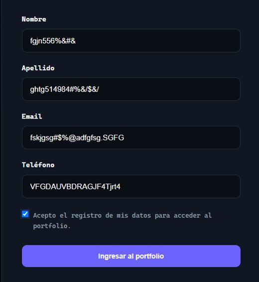
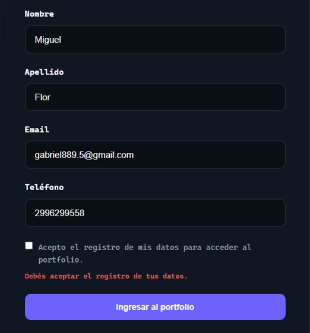

# Bug Reports

## BUG-001 — Phone field accepts alphabetic characters

### Status

CLOSED

### Severity

Medium

### Priority

High

### Requirement

FR-008

### Test Case

TC-012

---

### Environment

Operating System:

Windows

Browser:

Google Chrome

Application:

Miguel Flor QA & AI Portfolio

Version:

1.0

---

### Preconditions

El usuario se encuentra en la pantalla
de registro.

---

### Steps to Reproduce

1. Abrir la aplicación.
2. Ingresar un nombre válido.
3. Ingresar un apellido válido.
4. Ingresar un email válido.
5. Ingresar `abc` en el campo teléfono.
6. Aceptar consentimiento.
7. Presionar "Ingresar al portfolio".

---

### Expected Result

El sistema debe rechazar el valor
introducido en el campo teléfono.

Debe mostrarse un mensaje de validación.

---

### Actual Result

La prueba de regresión confirmó que el sistema
rechaza el teléfono `abc` y muestra el mensaje
de validación correspondiente. El acceso queda
bloqueado cuando se ingresa ese valor.
---

### Evidence

---

### Related Requirement

FR-008

---

### Related Test Case

TC-012
