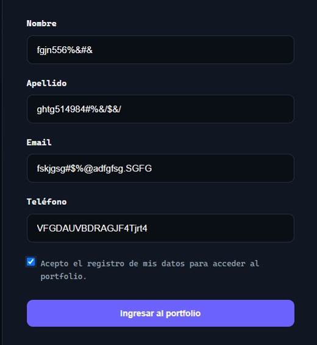
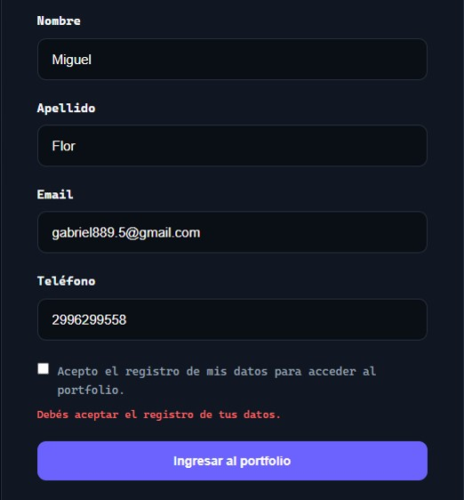

# Bug Reports

## BUG-001 — Phone field accepts alphabetic characters

### Status

CLOSED

### Severity

Medium

### Priority

High

### Requirement

FR-008

### Test Case

TC-012

---

### Environment

Operating System:

Windows

Browser:

Google Chrome

Application:

Miguel Flor QA & AI Portfolio

Version:

1.0

---

### Preconditions

El usuario se encuentra en la pantalla
de registro.

---

### Steps to Reproduce

1. Abrir la aplicación.
2. Ingresar un nombre válido.
3. Ingresar un apellido válido.
4. Ingresar un email válido.
5. Ingresar `abc` en el campo teléfono.
6. Aceptar consentimiento.
7. Presionar "Ingresar al portfolio".

---

### Expected Result

El sistema debe rechazar el valor
introducido en el campo teléfono.

Debe mostrarse un mensaje de validación.

---

### Actual Result — Defecto original

Durante la ejecución inicial, el campo teléfono
aceptaba caracteres alfabéticos como `abc`,
incumpliendo la validación esperada para FR-008.

### Regression Result — Verificación posterior

Después de aplicar la corrección, la prueba de
regresión TC-012 confirmó que el sistema rechaza
el teléfono `abc` y muestra el mensaje de
validación correspondiente.

El acceso al portfolio permanece bloqueado
cuando se ingresa ese valor.

### Automated Regression Verification

**Fecha:** 30/10/2026

**Herramienta:** Selenium WebDriver / Node.js

**Archivo:** `tests/selenium/phone-validation-boundaries.test.js`

**Escenario:** BUG-001 — Teléfono con caracteres alfabéticos.

**Dato de prueba:** `12345abc`

**Resultado esperado:**

- El teléfono debe ser rechazado.
- Debe mostrarse `Ingresá un teléfono válido.`
- El portfolio debe permanecer oculto.

#### Results by Browser

| Navegador | Resultado |
|---|---|
| Google Chrome | PASS |
| Mozilla Firefox | PASS |
| Microsoft Edge | PASS |

**Resultado específico de BUG-001:** 3/3 PASS.

La prueba forma parte de una suite de 11 escenarios de validación del teléfono, ejecutada en los tres navegadores.

**Resultado general de la suite:** 33/33 PASS — 0 FAIL.

Esta verificación complementa el caso histórico TC-012 y confirma el comportamiento posterior a la corrección.

No constituye una nueva reproducción del defecto original.

---

### Final Status

CLOSED — Corrección verificada mediante TC-012.

---

### Evidence

---

### Related Requirement

FR-008

---

### Related Test Case

TC-012

---

## BUG-002 — First name accepts invalid characters

### Status

CLOSED — Corrección histórica documentada.

### Module

Formulario de acceso — Campo Nombre.

### Related Requirements

- FR-012 — Validación de Nombre y Apellido.
- FR-002 — Campos obligatorios (requisito complementario).

### Related Test Cases

**Verificación directa del defecto:**

- `tests/selenium/invalid-first-name-numeric.test.js`
- Dato de prueba: `sdfh567`.
- Resultado: 3/3 PASS (Chrome, Firefox y Edge).

**Verificación complementaria:**

- UI-004 — Nombre demasiado corto.
- `tests/selenium/invalid-first-name.test.js`
- Dato de prueba: `M`.
- Resultado: 3/3 PASS (Chrome, Firefox y Edge).

Las pruebas verifican condiciones diferentes
del mismo campo y no deben considerarse
escenarios equivalentes.

### Automated Test Reference

`tests/selenium/invalid-first-name.test.js`

### Defect Description

Durante el desarrollo se detectó que el
campo Nombre aceptaba valores que contenían
números o caracteres no permitidos.

El defecto fue informado y corregido antes
de registrarse formalmente.

### Expected Result

El sistema debe rechazar nombres que
contengan números o caracteres no admitidos.

Debe mostrar un mensaje de validación
e impedir el acceso con datos inválidos.

### Actual Result — Original Defect

El campo Nombre permitía introducir
valores con un formato incorrecto.

### Implemented Fix

Se corrigió la validación del campo Nombre
para rechazar los formatos no admitidos.

### Post-Fix Evidence

La evidencia visual disponible muestra
el campo Nombre con un valor que contiene
números y el mensaje:

"Ingresá un nombre válido."

La captura corresponde al comportamiento
posterior a la corrección.

### Evidence Limitation

No se capturó evidencia visual del defecto
antes de implementar la corrección.

El problema fue comunicado durante el
desarrollo y registrado posteriormente.

### Regression Verification

Se verificó el comportamiento corregido mediante
pruebas automatizadas de Selenium WebDriver.

**Archivo de prueba:**
`tests/selenium/invalid-first-name-numeric.test.js`

**Dato de prueba:** `sdfh567`

**Fecha de ejecución:** 30/10/2026

#### Resultados por navegador

| Browser | Result |
|---|---|
| Google Chrome | PASS |
| Mozilla Firefox | PASS |
| Microsoft Edge | PASS |

**Resultado consolidado:** 3/3 PASS.

La prueba confirmó en los tres navegadores que:

- El nombre con números es rechazado.
- Se muestra `Ingresá un nombre válido.`
- El portfolio permanece oculto.

#### Validación complementaria

UI-004 verifica el rechazo de nombres
demasiado cortos (`M`).

**Archivo:**
`tests/selenium/invalid-first-name.test.js`

| Browser | Result |
|---|---|
| Google Chrome | PASS |
| Mozilla Firefox | PASS |
| Microsoft Edge | PASS |

**Resultado complementario:** 3/3 PASS.

#### Evidence Limitation

Estas ejecuciones confirman el comportamiento
posterior a la corrección de BUG-002.

No constituyen evidencia de una ejecución
anterior a la corrección del defecto.

### Final Status

CLOSED — Defecto corregido según el
registro histórico del desarrollo.

### Documentation Notes

Fecha individual de detección, severidad
y prioridad no recuperadas.

---

## BUG-003 — Last name accepts invalid characters

### Status

CLOSED — Corrección histórica documentada.

### Module

Formulario de acceso — Campo Apellido.

### Related Requirements

- FR-012 — Validación de Nombre y Apellido.
- FR-002 — Campos obligatorios (requisito complementario).

### Related Test Cases

**Verificación directa del defecto:**

- `tests/selenium/invalid-last-name-numeric.test.js`
- Dato de prueba: `Flor567`.
- Resultado: 3/3 PASS (Chrome, Firefox y Edge).

**Verificación complementaria:**

- UI-005 — Apellido demasiado corto.
- `tests/selenium/invalid-last-name.test.js`
- Dato de prueba: `F`.
- Resultado: 3/3 PASS (Chrome, Firefox y Edge).

Las pruebas verifican condiciones diferentes
del mismo campo y no deben considerarse
escenarios equivalentes.

### Defect Description

Durante el desarrollo se detectó que el campo
Apellido permitía valores que contenían números
o caracteres no admitidos.

El comportamiento fue corregido antes de
documentarse formalmente el defecto.

### Expected Result

El formulario debe rechazar apellidos que
contengan números o caracteres no permitidos,
mostrar el mensaje correspondiente e impedir
el acceso al portfolio.

### Actual Result — Original Defect

Durante el desarrollo, el campo permitía
valores con formato incorrecto.

### Implemented Fix

Se corrigió la validación del campo Apellido
para rechazar valores que no cumplan las
reglas establecidas.

### Post-Fix Evidence

Se dispone de evidencia visual obtenida
después de la corrección.

No se dispone de una captura del
comportamiento original anterior al arreglo.

### Regression Verification

Se verificó el comportamiento corregido mediante
pruebas automatizadas de Selenium WebDriver.

**Archivo de prueba:**
`tests/selenium/invalid-last-name-numeric.test.js`

**Dato de prueba:** `Flor567`

**Fecha de ejecución:** 30/10/2026

#### Resultados por navegador

| Browser | Result |
|---|---|
| Google Chrome | PASS |
| Mozilla Firefox | PASS |
| Microsoft Edge | PASS |

**Resultado consolidado:** 3/3 PASS.

La prueba confirmó en los tres navegadores que:

- El apellido con números es rechazado.
- Se muestra `Ingresá un apellido válido.`
- El portfolio permanece oculto.

#### Validación complementaria

UI-005 verifica el rechazo de apellidos
demasiado cortos (`F`).

**Archivo:**
`tests/selenium/invalid-last-name.test.js`

| Browser | Result |
|---|---|
| Google Chrome | PASS |
| Mozilla Firefox | PASS |
| Microsoft Edge | PASS |

**Resultado complementario:** 3/3 PASS.

#### Evidence Limitation

Estas ejecuciones confirman el comportamiento
posterior a la corrección de BUG-003.

No constituyen evidencia de una ejecución
anterior a la corrección del defecto.

### Final Status

CLOSED — Corrección histórica con
regresión automatizada satisfactoria.

### Documentation Notes

La ejecución actual confirma el comportamiento
posterior a la corrección, pero no reproduce
el estado original del defecto.

La fecha individual de detección, la severidad
y la prioridad históricas no están confirmadas.

---

## BUG-004 — Email format validation

### Status

CLOSED — Corrección histórica documentada.

### Module

Formulario de acceso — Campo Email.

### Defect Description

Durante el desarrollo se identificó un defecto
relacionado con la validación del formato
del correo electrónico.

El comportamiento fue corregido antes de
documentarse formalmente el defecto.

No se dispone de información suficiente para
establecer qué formatos específicos eran
aceptados incorrectamente antes de la corrección.

### Expected Result

El formulario debe rechazar los correos que
no cumplan las reglas de formato establecidas,
mostrar el mensaje correspondiente e impedir
el acceso al portfolio.

### Actual Result — Original Defect

Se registró históricamente un problema en la
validación del formato de correo electrónico.

No se conserva una reproducción verificable
del comportamiento original.

### Implemented Fix

Se corrigió la validación del campo Email.

La implementación actual rechaza los cinco
formatos evaluados en la regresión automatizada.

### Post-Fix Evidence

Se dispone de una captura posterior a la
corrección que muestra el rechazo de:

`gabriel@@gmail.com`

El formulario presenta el mensaje:

`Ingresá un email válido.`

La captura no demuestra el comportamiento
anterior a la corrección.

### Regression Verification

**Archivo:**
`tests/selenium/invalid-email-double-at.test.js`

**Fecha de ejecución:** 30/10/2026

#### Scenarios

| Test Data | Chrome | Firefox | Edge |
|---|---|---|---|
| `gabriel@@gmail.com` | PASS | PASS | PASS |
| `gabriel@` | PASS | PASS | PASS |
| `gabriel@prueba` | PASS | PASS | PASS |
| `@gmail.com` | PASS | PASS | PASS |
| `gabriel@gmail.` | PASS | PASS | PASS |

**Resultado consolidado:** 15/15 PASS.

En cada escenario se verificó que:

- Se muestra `Ingresá un email válido.`
- El portfolio permanece oculto.

El rechazo de `gabriel@prueba` corresponde
a las reglas implementadas en el portfolio.

#### Complementary Verification

**Test Case:** UI-003

**Archivo:**
`tests/selenium/invalid-email.test.js`

**Dato de prueba:** `correo-invalido`

| Browser | Result |
|---|---|
| Google Chrome | PASS |
| Mozilla Firefox | PASS |
| Microsoft Edge | PASS |

**Resultado complementario:** 3/3 PASS.

### Evidence Limitation

Las pruebas automatizadas verifican el
comportamiento posterior a la corrección.

No existe evidencia suficiente para reconstruir
el defecto original con precisión.

### Final Status

CLOSED — Corrección histórica documentada
con regresión multinavegador satisfactoria.

### Documentation Notes

La fecha individual de detección, la severidad
y la prioridad históricas no están confirmadas.

Los resultados históricos anteriores
permanecen sin modificaciones.

---

## BUG-005 — Phone maximum length validation

### Status

CLOSED — Corrección histórica documentada.

### Module

Formulario de acceso — Campo Teléfono.

### Defect Description

Durante el desarrollo del portfolio se identificó un defecto relacionado con la validación de la longitud máxima del teléfono.

El comportamiento reportado permitía ingresar un número que superaba el límite establecido de 15 dígitos.

El defecto fue corregido durante el desarrollo.

### Expected Result

El sistema debe:

1. Aceptar teléfonos que contengan entre 7 y 15 dígitos.
2. Rechazar teléfonos con menos de 7 dígitos.
3. Rechazar teléfonos con más de 15 dígitos.
4. Mostrar el mensaje de validación correspondiente.
5. Impedir el acceso al portfolio cuando el teléfono sea inválido.

Los espacios, guiones, paréntesis y el signo `+` pueden utilizarse como caracteres de formato según las reglas implementadas.

### Actual Result — Original Defect

Se identificó históricamente una validación incorrecta de la longitud máxima del teléfono.

No se dispone de una ejecución automatizada del estado original que permita reproducir y medir el defecto antes de su corrección.

### Implemented Fix

La validación actual utiliza la función `isValidPhone()` de `js/app.js`.

Esta función:

- Elimina los caracteres no numéricos para contar los dígitos.
- Verifica que existan al menos 7 dígitos.
- Verifica que no se superen los 15 dígitos.
- Comprueba que los caracteres ingresados estén permitidos.

Cuando el teléfono es inválido, el formulario muestra:

`Ingresá un teléfono válido.`

El acceso al portfolio permanece bloqueado.

### Regression Verification

**Fecha:** 30/10/2026

**Herramienta:** Selenium WebDriver / Node.js

**Archivo:** `tests/selenium/phone-validation-boundaries.test.js`

**Escenario directamente relacionado:** BUG-005 — Teléfono de 16 dígitos.

**Dato de prueba:** `1234567890123456`

**Resultado esperado:** rechazo del teléfono, visualización del mensaje de error y portfolio oculto.

### Results by Browser

| Navegador | Escenario BUG-005 | Resultado |
|---|---|---|
| Google Chrome | 16 dígitos | PASS |
| Mozilla Firefox | 16 dígitos | PASS |
| Microsoft Edge | 16 dígitos | PASS |
| **Total** | **3 ejecuciones** | **3/3 PASS** |

### Complementary Verification

La suite también verificó:

- Aceptación de teléfonos de 7, 8 y 15 dígitos.
- Rechazo de caracteres alfabéticos.
- Aceptación de espacios, guiones y paréntesis.
- Aceptación del prefijo internacional.
- Rechazo de símbolos no permitidos.
- Rechazo de entradas compuestas únicamente por símbolos.

**Resultado general de la suite:**

33/33 PASS — 0 FAIL.

Los resultados completos están documentados en `docs/test-report.md`.

La prueba UI-006, correspondiente al rechazo de teléfonos demasiado cortos, permanece documentada por separado en `tests/selenium/invalid-phone.test.js`.

### Evidence Limitation

La regresión automatizada verifica el comportamiento actual posterior a la corrección.

No constituye una reproducción del defecto original.

No se asignan fechas individuales de detección o corrección, ni valores históricos de severidad o prioridad, sin evidencia documental que los respalde.

### Final Status

CLOSED — Corrección histórica documentada y regresión multinavegador satisfactoria.

---

## BUG-006 — Incorrect navigation route in Global Search

### Status

CLOSED

### Module

Global Search

### Related Requirement

FR-011 — Global Search

### Related Test Cases

SEARCH-TC-033 — Verificación del destino
`frontend.html#internacionalizacion` mediante
normalización Unicode.

SEARCH-TC-043 — Navegación automatizada hacia
`frontend.html#internacionalizacion`, comprobación
de la URL, visibilidad de la sección y posición
respecto de la cabecera fija.

### Automated Regression

Fecha: 30/10/2026.

- Google Chrome: 43 PASS.
- Mozilla Firefox: 43 PASS.
- Microsoft Edge: 43 PASS.
- Total: 129 PASS / 0 FAIL.

La regresión incluye SEARCH-TC-033 y
SEARCH-TC-043 en los tres navegadores.

### Environment

Application: Miguel Flor QA & AI Portfolio

Component: Global Search

File: `js/search.js`

### Defect Description

El buscador global contenía una referencia
de navegación hacia `qa-frontend.html`.

Esta ruta era incorrecta porque la página
real del portfolio se llama `frontend.html`.

### Expected Result

Al seleccionar un resultado relacionado
con Frontend, el buscador debe navegar
hacia la página `frontend.html`.

### Actual Result — Original Defect

La configuración del buscador utilizaba
la ruta inexistente `qa-frontend.html`.

### Root Cause

Referencia incorrecta al nombre del
archivo de la página Frontend.

### Implemented Fix

Se actualizaron las rutas correspondientes
en `js/search.js` para utilizar `frontend.html`.

### Regression Result

La regresión funcional manual del buscador
global finalizó con:

- Casos ejecutados: 17.
- PASS: 17.
- FAIL: 0.

La regresión manual documenta el funcionamiento
general del buscador en las páginas evaluadas.

La verificación específica de la navegación
hacia `frontend.html#internacionalizacion`
está respaldada por SEARCH-TC-043,
mientras que SEARCH-TC-033 comprueba
la referencia de destino generada.

### Final Status

CLOSED — Corrección documentada y navegación
verificada mediante regresión funcional.

### Evidence Reference

Consultar `docs/test-report.md`,
sección "Regresión funcional — Buscador global".

### Observations

La documentación disponible no especifica
una fecha individual de detección, severidad
ni prioridad para BUG-006.

Estos datos permanecen sin asignar hasta
recuperar la evidencia original.

---

## BUG-SEARCH-001 — Repeated spaces prevent search results

### Status

CLOSED

### Severity

Low

### Priority

Medium

### Module

Global Search

### Related Requirement

FR-011 — Global Search

### Related Test Case

SEARCH-TC-031

---

### Environment

Operating System: Windows

Browser: Google Chrome

Application: Miguel Flor QA & AI Portfolio

Module: Global Search

---

### Preconditions

El usuario se encuentra en una página del portfolio
con el buscador global disponible.

---

### Steps to Reproduce

1. Abrir `quality-management.html`.
2. Localizar el buscador global.
3. Introducir `arquitectura   api`, utilizando tres espacios entre las palabras.
4. Observar los resultados.

---

### Expected Result

El buscador debe interpretar los espacios internos
consecutivos como un único espacio.

La consulta `arquitectura   api` debe encontrar
el mismo resultado que `arquitectura api`.

---

### Actual Result — Original Defect

El buscador mostraba:

`No se encontraron resultados.`

La búsqueda `arquitectura api`, utilizando un único
espacio, encontraba correctamente:

`Arquitectura de la API`.

El comportamiento fue reproducido manualmente y
detectado mediante SEARCH-TC-031.

---

### Root Cause

La función `normalize` de `js/search.js`
normalizaba mayúsculas y acentos, pero no
los espacios internos consecutivos.

---

### Implemented Fix

Se incorporaron las operaciones:

`.replace(/\s+/g, " ")`

`.trim()`

La normalización se aplica a consultas, títulos,
descripciones y palabras clave.

---

### Regression Result

**Related Test Case:** SEARCH-TC-031 — PASS.

**Automated regression:**

File: `tests/selenium/global-search-navigation.test.js`

| Metric | Chrome | Firefox | Edge | Total |
|---|---:|---:|---:|---:|
| Tests executed | 43 | 43 | 43 | 129 |
| Passed | 43 | 43 | 43 | 129 |
| Failed | 0 | 0 | 0 | 0 |
| Cancelled | 0 | 0 | 0 | 0 |
| Skipped | 0 | 0 | 0 | 0 |
| Pass rate | 100% | 100% | 100% | 100% |

**Verification:**

- SEARCH-TC-031 passed.
- Full automated regression passed in all three browsers.
- Final Chrome regression was repeated after the keyboard
  navigation test adaptations.
- No failures were recorded in the final executions.

**Result:** PASS — 129/129.

---

### Final Status

CLOSED — Corrección verificada mediante
SEARCH-TC-031 y regresión automatizada completa.

---
